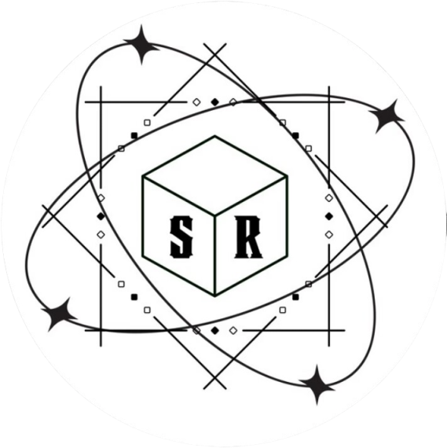
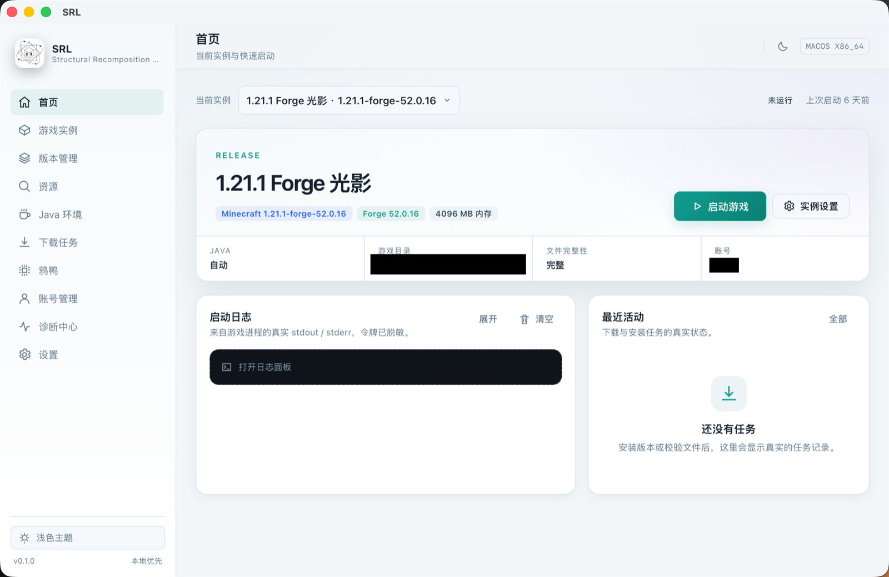
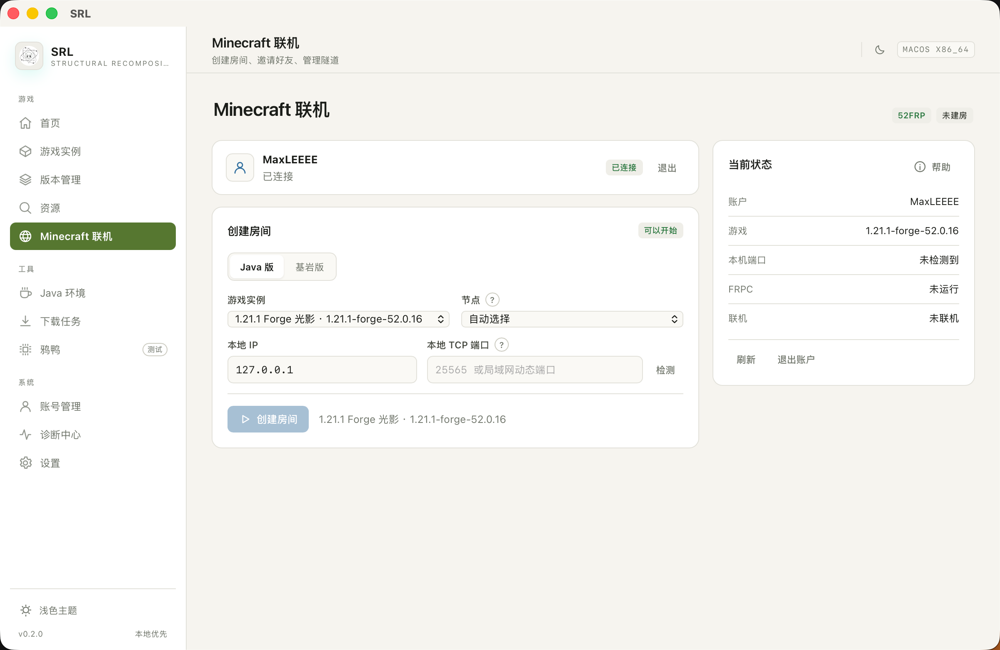

<div align="center">
  
  <h1>SRL</h1>
  <p><strong>Structural Recomposition Launcher</strong></p>
  <p>Local-first · Verifiable downloads · Real launches · Honest diagnostics</p>

  [](LICENSE)
  [](https://tauri.app)
  [](https://www.rust-lang.org)
  [](https://react.dev)
  [](#platform-support)
</div>

**English** · [简体中文](README.md)

> **SRL** is an independent, cross-platform Minecraft: Java Edition launcher. It has no self-hosted backend: versions, instances, accounts and logs stay on your machine. Downloads are hash-verified, launches use real processes and real arguments, and failures come with reproducible evidence instead of guesses.
>
> This project is not affiliated with Mojang, Microsoft, PCL2 or HMCL. “Minecraft” is a trademark of Mojang Studios.

> **Microsoft login:** due to current development constraints, SRL cannot yet offer out-of-the-box Microsoft sign-in. You currently need to register your own Azure application, obtain a `client id` and enter it in Settings; the login entry is explicitly disabled until then.

> **Current version: `v0.2.1` (bilingual UI · bundled FRPC · modpack export)** — installers, screenshots and checksums are on [GitHub Releases](https://github.com/sry8n5rjz5-debug/SRL/releases/tag/v0.2.1).

---

## Contents

- [Why SRL](#why-srl)
- [Features](#features)
- [Screenshots](#screenshots)
- [Download & install](#download--install)
- [Build from source](#build-from-source)
- [Tests & quality](#tests--quality)
- [Project layout](#project-layout)
- [Data locations](#data-locations)
- [Security & privacy](#security--privacy)
- [Platform support](#platform-support)
- [Known limitations](#known-limitations)
- [License](#license)

## Why SRL

- **Local-first.** No account server, no telemetry, no cloud instances. The launcher only contacts Mojang, Modrinth, CurseForge, Adoptium and similar services when you use a feature that needs them.
- **Verifiable downloads.** SHA-1/SHA-256 checks, atomic writes, safe resume, bounded concurrency and retry backoff.
- **Real launches.** A real Java process, real classpath and arguments, visible stdout/stderr.
- **Honest boundaries.** Unsupported combinations are refused with a reason instead of silently “fixing” them.
- **Bilingual UI.** Switch between Simplified Chinese and English in Settings; Chinese is the default.

## Features

| Area | Status | Notes |
|---|---|---|
| Version install | ✅ | Client JAR, libraries, natives, asset index; optional assets |
| Download engine | ✅ | Bounded concurrency, cancellation, retry backoff, SHA-1 verification, atomic writes, safe resume |
| China mirrors | ✅ | BMCLAPI / USTC / Tsinghua TUNA with automatic fallback to official sources |
| Java runtime | ✅ | Discovery plus one-click Temurin 8–27 install, SHA-256 verified |
| Loaders | ✅ | Fabric, Quilt, Forge, NeoForge, Iris, OptiFine |
| Instances | ✅ | Independent game directories, Java, memory, JVM/game args and resolution |
| Mods / resource packs / shaders | ✅ | Import, enable/disable, delete, open folder |
| Modpack install | ✅ | Modrinth `.mrpack`, CurseForge `manifest.zip`, plain modpack ZIP |
| Modpack export | ✅ | Modrinth `.mrpack` and CurseForge `manifest.json`; unresolved mods go to `overrides/` |
| Instance archive | ✅ | Safe ZIP export/import with path-traversal and symlink checks |
| Multiplayer | ✅ | 52FRP API, Java/Bedrock tunnels, node selection, bundled FRPC |
| Diagnostics | ✅ | Environment checks, logs, crash reports, redacted report export |
| Bilingual UI | ✅ | Simplified Chinese / English, default Chinese |

### v0.2.1 highlights

- **Bundled FRPC.** Each installer ships the official frp client for its platform/architecture, pinned by SHA-256. The first use verifies and extracts it locally; room creation no longer waits for GitHub. Network download remains only as a fallback.
- **Modpack export.** Export an instance as a Modrinth `.mrpack` or a CurseForge `manifest.json` ZIP. Mods are matched by SHA-1 (Modrinth) or the official Murmur2 fingerprint (CurseForge); unknown or disabled mods, configs, resource packs and shaders are placed in `overrides/`. Worlds, logs and tokens are excluded.
- **Bilingual interface.** A language selector in Settings switches the whole UI between Simplified Chinese and English and reloads the window. Chinese remains the default.
- **Packaging.** macOS DMG, Windows x64 portable ZIP, Linux deb and AppImage are produced by the release workflow.

## Screenshots

<p align="center">
  
  
</p>
<p align="center">
  
</p>

## Download & install

| Platform | File |
|---|---|
| macOS 10.15+ | `SRL_0.2.1_universal.dmg` (Intel + Apple Silicon, unsigned) |
| Windows 10/11 x64 | `SRL_0.2.1_windows-x64-portable.zip` |
| Linux x64 | `SRL_0.2.1_amd64.deb` |
| Linux x64 | `SRL_0.2.1_amd64.AppImage` |

Checksums: `SHA256SUMS` in the release assets.

### macOS

Open the DMG, drag SRL to Applications. The build is unsigned and not notarized, so Gatekeeper may warn. If needed:

```bash
xattr -dr com.apple.quarantine /Applications/SRL.app
```

### Windows

Extract the whole ZIP and run `Install.cmd` (no administrator rights required), or run `sr-launcher.exe` directly. WebView2 Runtime is required and is normally present on Windows 10/11.

### Linux

```bash
sudo apt install ./SRL_0.2.1_amd64.deb
```

or run the AppImage. WebKitGTK 4.1 and GTK 3 are required.

## Build from source

Requirements: Node.js ≥ 20, Rust ≥ 1.77, plus the Tauri platform prerequisites.

```bash
npm install
npm run build           # TypeScript + Vite
npm run build:desktop   # Tauri bundle
```

`beforeBuildCommand` runs `scripts/fetch-frpc.mjs`, which downloads and SHA-256 verifies the official frp archive for the current target into `src-tauri/resources/frpc/<platform>/<arch>/`. The archive is not committed.

```bash
node scripts/fetch-frpc.mjs --targets=darwin-amd64,darwin-arm64
node scripts/fetch-frpc.mjs --version=0.71.0
```

## Tests & quality

```bash
npm test
cargo test --workspace
cargo fmt --check
cargo clippy --workspace --all-targets -- -D warnings
```

The suite covers version resolution, download resume/checksum/atomic writes, instance import/export, Modrinth and CurseForge modpack export (including real-network tests), FRPC bundle extraction, and the React UI.

## Project layout

```
crates/sr-core/       Rust core: versions, downloads, instances, mods, multiplayer
src-tauri/            Tauri commands and desktop shell
src/                  React UI, i18n dictionaries
scripts/              Release, verification and frpc fetch scripts
release/              Release notes and local packaging notes
docs/                 Build notes and screenshots
```

## Data locations

| Platform | Path |
|---|---|
| macOS | `~/Library/Application Support/app.srlauncher.desktop` |
| Windows | `%APPDATA%\app.srlauncher.desktop` |
| Linux | `~/.local/share/app.srlauncher.desktop` |

Game files live in the Minecraft directory configured in Settings (default: `minecraft/` under the data directory).

## Security & privacy

- No telemetry and no automatic uploads.
- Account tokens live in the OS credential store, never in settings or logs.
- Downloads require HTTPS and trusted hosts; files are hash-verified.
- The network permission is used only for Mojang, Modrinth, CurseForge, Adoptium, 52FRP and the official frp release.

## Platform support

| Platform | Status |
|---|---|
| macOS 10.15+ (Intel / Apple Silicon) | ✅ |
| Windows 10/11 x64 | ✅ |
| Linux x64 (Debian / Ubuntu, AppImage) | ✅ |

## Known limitations

- Microsoft login requires your own Azure application `client id`.
- CurseForge search and modpack import/export use a bundled public API key; heavy use may be rate-limited.
- The macOS build is unsigned and not notarized.
- Mods that cannot be identified are redistributed inside `overrides/`; make sure their licenses allow it before sharing a pack.

## License

MIT. Third-party notices are in [`THIRD_PARTY_NOTICES.md`](src-tauri/resources/THIRD_PARTY_NOTICES.md). Bundled frpc is Apache-2.0; see `src-tauri/resources/frpc/LICENSE`.
