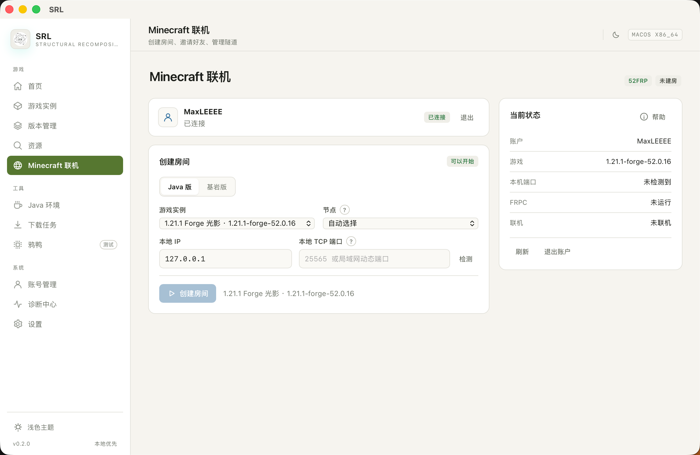
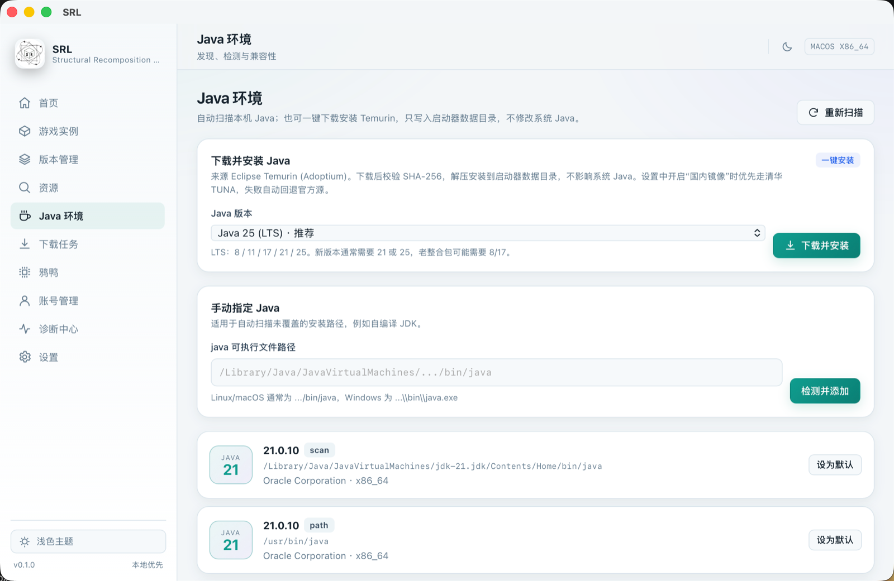

<div align="center">
  
  <h1>SRL</h1>
  <p><strong>Structural Recomposition Launcher for Minecraft</strong></p>
  <p>本地优先 · 下载可验证 · 启动真实 · 错误可诊断</p>

  [](LICENSE)
  [](https://tauri.app)
  [](https://www.rust-lang.org)
  [](https://react.dev)
  [](#平台支持)
</div>

**简体中文** · [English](README.en.md)

> **SRL** 是一个独立实现的跨平台 Minecraft Java Edition 启动器。它不依赖自建服务端，所有版本、实例、账号与日志都保存在本机；下载的文件经过哈希校验，启动过程使用真实进程与真实参数，出错时给出可复现的证据而不是猜测。
>
> 本项目与 Mojang、Microsoft、PCL2、HMCL 均无隶属关系。“Minecraft”是 Mojang Studios 的商标。

> **关于 Microsoft 正版登录：** 很抱歉，受当前开发条件限制，SRL 还不能做到开箱即用的 Microsoft 正版登录。目前需要玩家自行注册 Azure 应用、获取 `client id` 并在设置中填写；未配置时登录入口会明确禁用。我们会在后续版本继续修复，感谢理解。

**English:** SRL (Structural Recomposition Launcher) is an independent, local-first Minecraft: Java Edition launcher built with Rust, Tauri 2, React and TypeScript. It focuses on verifiable downloads, real process launching, clear diagnostics, and honest capability boundaries. No telemetry, no proprietary game files, MIT licensed.

> **当前版本：`v0.2.1`（中英双语 · 内置 FRPC · 整合包导出）** · 使用 52FRP 开放 API；安装包、截图与校验值见 [GitHub Releases](https://github.com/sry8n5rjz5-debug/SRL/releases/tag/v0.2.1)。

### v0.2.1 更新摘要

- **中英双语界面。** 设置中新增语言切换，默认简体中文；切换后界面重新加载。
- **FRPC 安装包内置。** 按平台/架构携带官方 frp 客户端并锁定 SHA-256，创建房间不再等待 GitHub；网络下载仅作为内置缺失时的回退。
- **整合包导出。** 支持 Modrinth `.mrpack` 与 CurseForge `manifest.json` ZIP；Modrinth 走 SHA-1，CurseForge 走官方 Murmur2 指纹，未识别模组进入 `overrides/`。
- **三平台安装包。** macOS DMG、Windows x64 便携 ZIP、Linux deb / AppImage。

---

## 目录

- [为什么是 SRL](#为什么是-srl)
- [功能总览](#功能总览)
- [界面](#界面)
- [下载与安装](#下载与安装)
- [从源码构建](#从源码构建)
- [测试与质量](#测试与质量)
- [项目结构](#项目结构)
- [数据位置](#数据位置)
- [安全与隐私](#安全与隐私)
- [平台支持](#平台支持)
- [已知限制](#已知限制)
- [路线图](#路线图)
- [贡献](#贡献)
- [许可与第三方](#许可与第三方)

## 为什么是 SRL

- **本地优先。** 没有自建账号服务器、没有遥测、没有云端实例。启动器只在你主动使用某个功能时访问 Mojang、Modrinth、CurseForge、Adoptium 等第三方接口。
- **下载可验证。** 客户端 JAR、库、资源、加载器、模组与安装包都尽可能使用官方哈希校验；所有落盘路径经过 `safe_join`，拒绝路径穿越与符号链接。
- **启动是真实的。** 用参数数组构造 classpath 与 JVM 参数，直接创建 Java 进程，读取真实 stdout/stderr 与退出码，不模拟“启动成功”。
- **错误可诊断。** 崩溃报告、日志、Java 版本、加载器、模组列表与下载任务都有结构化证据；无法判断时明确说“不知道”，不编造根因。
- **边界写清楚。** 已实现、部分验证、未实现分别标注。计划中的能力不会出现在“已支持”列表里。

## 功能总览

状态说明：✅ 已实现并有测试；🟡 已实现但部分场景未实机验证；⛔ 尚未实现。

### 版本与安装

| 能力 | 状态 | 说明 |
|---|---|---|
| 官方版本清单 | ✅ | Mojang `version_manifest_v2`，6 小时缓存，断网时回退本地缓存 |
| 版本元数据解析 | ✅ | 完整解析规则、库、natives、资源索引；未知字段保留 |
| 版本分类浏览 | ✅ | 正式版 / 快照 / 旧 Beta / 旧 Alpha 分栏，显示数量与最新版入口 |
| 一键安装 | ✅ | 客户端 JAR、库、natives、资源索引；资源文件可选 |
| 版本继承合并 | ✅ | 递归解析、循环检测、库去重与覆盖 |
| 平台 / 特性规则 | ✅ | `allow` / `disallow`、`os`、`arch`、`features` 求值 |
| 本地版本管理 | ✅ | 查看类型、加载器、大小、修改时间；打开目录、创建实例、检查、删除 |
| 文件完整性检查 | ✅ | JAR / 库哈希、资源存在性与大小 |
| 下载引擎 | ✅ | 并发上限、取消、重试退避、SHA-1 校验、原子写入、安全断点续传 |
| 任务持久化 | ✅ | 历史写入 `cache/tasks.json`；重启后未完成任务标记为“中断”，不自动重放 |
| 国内镜像 | ✅ | BMCLAPI / USTC / 清华 TUNA；失败自动回退官方源 |

### Java 运行时

| 能力 | 状态 | 说明 |
|---|---|---|
| Java 自动发现 | ✅ | `JAVA_HOME`、`PATH`、macOS `java_home -V` 与平台默认目录；只读探测，不修改系统 Java |
| 版本兼容性 | ✅ | 基于版本元数据 `javaVersion.majorVersion`；不兼容时明确拒绝启动 |
| 按版本自动选择 | ✅ | 1.12.2 → Java 8，1.21.1 → Java 21，26.x → Java 25；优先精确匹配，其次安全范围内的默认 Java |
| 每实例覆盖 | ✅ | 实例可单独指定 Java，优先级高于全局默认 |
| 一键安装 Temurin | ✅ | Eclipse Temurin 8–27 可选；下载 → SHA-256 校验 → 解压到启动器数据目录 → 自动识别 |
| 国内镜像加速 | ✅ | 开启“国内镜像”后优先使用清华 TUNA 的 Adoptium 镜像；镜像缺失或不可用时自动回退 Adoptium 官方 |
| 校验不降级 | ✅ | 版本元数据仍来自 Adoptium API；镜像只改变下载地址，SHA-256 校验不变 |

> Java 一键安装不依赖系统预装 Java。安装后会出现在 Java 列表中，但不会顶掉已有默认；启动器会按实例版本自动选择。开启国内镜像后，下载优先走清华 TUNA，失败回退官方，校验值不变。

### 加载器与光影

| 能力 | 状态 | 说明 |
|---|---|---|
| Fabric | ✅ | 官方 meta + 镜像回退、继承解析、Maven `.sha1` 补齐、共享原版 JAR |
| Quilt | ✅ | 官方 meta + 构件镜像；真实 1.21.1 + Quilt 安装与完整性检查通过 |
| Forge | ✅ | 后台执行官方安装流程，不弹出安装器窗口；自动预下载镜像库并压平继承关系 |
| NeoForge | ✅ | 与 Forge 相同的后台安装流程；真实 1.21.1 安装与完整性检查通过 |
| 按版本推荐 | ✅ | 根据已安装版本推荐加载器与光影方案，可一键安装 |
| Iris | 🟡 | 从 Modrinth 选择兼容版本，SHA-1 校验后写入 `mods/`；部分网络环境需重试 |
| OptiFine | ✅ | Forge 实例中作为模组安装；按元数据校验 Forge 版本，不兼容时明确拒绝 |
| 光影包管理 | ✅ | `shaderpacks/` 列表、导入、启停、删除、打开目录；检测 Iris / OptiFine |

### 实例与内容

| 能力 | 状态 | 说明 |
|---|---|---|
| 多实例 | ✅ | 创建 / 编辑 / 复制 / 删除；独立目录、账号、内存、JVM 参数与窗口分辨率 |
| 实例导出 / 导入 | ✅ | 安全 ZIP 归档；校验路径穿越、重复路径、压缩比、符号链接与 Windows 保留名；排除日志与令牌 |
| 地图 / 存档 | ✅ | 读取 `saves/`，显示世界文件夹、区域文件数、占用空间与最后保存时间；只读浏览 |
| 模组管理 | ✅ | 拖拽 / 文件选择 / 路径导入 `.jar`，批量导入、启停、删除；原始字节 IPC，无 base64 膨胀 |
| 材质包管理 | ✅ | 列表、ZIP 导入、启停（同步 `options.txt`）、删除；校验 `pack.mcmeta` 与压缩包安全 |
| 光影包管理 | ✅ | `shaderpacks/` 列表、导入、启停、删除；离线皮肤包只读 |
| 整合包安装 | ✅ | Modrinth `.mrpack`、CurseForge `manifest.zip`、普通整合 ZIP；解析依赖并校验 SHA-1 |
| 整合包导出 | ✅ | 支持 Modrinth `.mrpack` 与 CurseForge `manifest.json` ZIP：可识别的模组写入索引（CurseForge 走官方指纹），其余模组与配置/资源包/光影进入 `overrides/`；排除存档、日志与令牌 |

### 账号与皮肤

| 能力 | 状态 | 说明 |
|---|---|---|
| 离线账号 | ✅ | 明确标识为离线档案，不冒充正版 |
| Microsoft 登录 | 🟡 | 设备码 + Xbox / Minecraft 交换，支持令牌刷新；需自行注册 Azure 应用并填写 client id，未配置时明确禁用。受开发条件限制，暂时无法开箱即用，敬请谅解 |
| 皮肤库 | ✅ | 内置默认皮肤、本地导入 64×64 / 128×128 / 旧版 64×32、按正版玩家名获取 |
| 皮肤模型 | ✅ | 标准 / 纤细模型；正版账号走官方上传，离线档案使用本机资源包（仅自己可见） |
| 皮肤格式适配 | ✅ | 从客户端 JAR 读取资源包格式，兼容 1.x 与 26.x |

### 社区资源

| 能力 | 状态 | 说明 |
|---|---|---|
| Modrinth | ✅ | 模组、整合包、光影、材质搜索；版本 / 加载器 / 分类筛选；安装到实例或下载到目录 |
| CurseForge | ✅ | 模组、整合包、光影、材质、地图搜索；官方 API；分类、Minecraft 版本与加载器筛选 |
| 下载校验 | ✅ | SHA-1 校验、可信域名限制、原子写入；失败自动清理 |
| 本地整合包导入 | ✅ | `.mrpack`、CurseForge `manifest.zip`、普通整合 ZIP；拒绝路径穿越、绝对路径、符号链接、保留名与异常压缩比 |

> CurseForge 搜索需要 API key。可在设置中保存个人 key（系统凭据库）；未配置时回退到项目内置的共享配置。共享配置只用于默认体验，公开部署或二次分发时请替换为你自己的 key。

### Minecraft 联机

| 能力 | 状态 | 说明 |
|---|---|---|
| 52FRP 账户 | ✅ | API 访问令牌（`hz_`）存系统凭据库；支持连接、验证、替换、退出 |
| 节点选择 | ✅ | 官方节点列表 + `/nodes/load`；按 available、在线、协议、隧道配额、延迟、负载评分；支持手动选择 |
| 创建隧道 | ✅ | `POST /v1/tunnels`；Java `tcp`、Bedrock `udp`；创建前检查名称与端口 |
| 端口分配 | ✅ | 遵守节点 `proxies_allowed` / `proxies_denied`，避开已占用端口并调用 `check-port` |
| FRPC 生命周期 | ✅ | 安装包内置官方 frpc（按平台/架构，SHA-256 锁定）；解压后启动、停止、重启、日志、异常退出；仅在内置缺失时回退 GitHub 下载 |
| 本地服务检测 | ✅ | Java 局域网动态端口日志 + 进程监听端口；Bedrock UDP 端口占用检查；支持手动 IP/端口 |
| 停止与清理 | ✅ | 停止 FRPC 与删除云端隧道分离；只删除 `SRL_` 前缀的临时隧道 |
| 真实联调 | 🟡 | 需要真实 52FRP 账户与 API 令牌；代码按官方 v1 OpenAPI 实现 |

> 联机中心不要求用户理解 FRP、公网 IP 或端口映射。房主启动游戏、创建房间并复制地址；朋友不需要开穿透，直接在 Minecraft 里直连即可。API 令牌在 52FRP 个人中心创建，只保存在系统凭据库。
>
> 联机页「当前状态」旁的「帮助」包含完整教程：52FRP 注册与实名、套餐/节点、API 令牌权限（创建和修改隧道与客户端）、房主开世界、朋友加入、离线联机模组和常见错误。
>
> 简要流程：房主在 Minecraft 中「对局域网开放」→ SRL 选择实例和本地端口 → 创建房间 → 复制公网地址；朋友打开同版本 Minecraft → 多人游戏 → 直接连接 → 粘贴地址。

### 诊断与 AI 助手

| 能力 | 状态 | 说明 |
|---|---|---|
| 崩溃报告分析 | ✅ | 解析 `crash-reports`，分类 OOM / Java 版本 / Mixin / 依赖 / 驱动问题；未识别时不臆测 |
| 日志查看 | ✅ | 启动器日志与实例日志列表、读取、清理、删除；敏感字段脱敏 |
| 环境诊断 | ✅ | Java、目录、版本、加载器、内存与网络配置检查 |
| 鸦鸭 AI 助手 | 🟡 | 本地证据解析、只读工具、DeepSeek 对话、审计日志、持久聊天记录 |
| 安全修复计划 | ✅ | 仅允许提高内存 / 禁用模组；执行前确认、备份、失败回滚、可手动回滚 |
| 带依赖的模组安装 | ✅ | 解析 Modrinth `required` 依赖，暂存 → SHA-1 → 备份 → 原子替换；失败回滚 |
| 整合包级助手操作 | ⛔ | 复制实例、启动测试、清单比较尚未实现 |

> 鸦鸭不配置 API key 时仍可做本地证据分析；配置 key 后才会调用 DeepSeek 兼容接口。工具调用有白名单、轮次与长度限制，默认只读。

## 界面

### 界面预览

<p align="center">
  
  
</p>
<p align="center"><sub>首页 · Minecraft 联机（52FRP 创建房间与帮助教程）</sub></p>

<p align="center">
  
  
</p>
<p align="center"><sub>资源（Modrinth / CurseForge） · 版本管理（安装、检查与实例）</sub></p>

<p align="center">
  
  
</p>
<p align="center"><sub>Java 环境（自动发现与 Temurin 安装） · 鸦鸭（测试中）</sub></p>

侧栏包含 11 个页面，均为真实功能入口：

| 页面 | 用途 |
|---|---|
| 首页 | 当前实例、快速启动、最近活动 |
| 游戏实例 | 实例列表、创建、编辑、复制、启动、导出 |
| 版本管理 | 官方版本清单、安装、本地版本检查与删除 |
| 资源 | Modrinth / CurseForge 搜索、筛选、详情、安装、本地整合包导入 |
| Minecraft 联机 | 52FRP 账户、节点、创建/停止房间、复制公网地址 |
| Java 环境 | 发现、手动添加、兼容性检查、Temurin 一键安装（支持国内镜像） |
| 下载任务 | 真实进度、速度、取消、历史记录 |
| 鸦鸭 | 崩溃诊断、证据分析、对话、修复计划、模组安装 |
| 账号管理 | 离线档案、Microsoft 登录、皮肤库 |
| 诊断中心 | 环境检查、崩溃报告、日志查看与导出 |
| 设置 | 游戏目录、并发数、主题、镜像、Java、API key |

## 下载与安装

### v0.2.1 下载

已构建好的安装包直接放在 GitHub Release，点开即可下载：

**https://github.com/sry8n5rjz5-debug/SRL/releases/tag/v0.2.1**

| 平台 | 文件 | 说明 |
|---|---|---|
| macOS 10.15+ | `SRL_0.2.1_universal.dmg` | Intel + Apple Silicon，未签名、未公证 |
| Windows 10/11 x64 | `SRL_0.2.1_windows-x64-portable.zip` | 需要 WebView2 Runtime；解压后运行 `Install.cmd` |
| Linux x64 | `SRL_0.2.1_amd64.deb` | 需要 WebKitGTK 4.1 等运行库 |
| Linux x64 | `SRL_0.2.1_amd64.AppImage` | 免安装；需要 FUSE 或 `--appimage-extract-and-run` |
| 校验 | `SHA256SUMS` | 所有附件的 SHA-256 |

> `release-assets/` 保存本次发布的构建产物，供维护者复核；普通用户直接下载 Release 附件即可。后续版本可以用 [`.github/workflows/build-installers.yml`](.github/workflows/build-installers.yml) 手动构建，再上传到对应 Release。

### 首次运行

**macOS**

应用未经过 Apple 公证，首次打开可能被 Gatekeeper 拦截：

```bash
xattr -dr com.apple.quarantine /Applications/SRL.app
```

或 Finder 中右键 → 打开 → 仍要打开。

**Windows**

- 完整解压 ZIP 后再运行，不要在压缩包预览中直接启动。
- 未签名，SmartScreen 可能提示；请先核对 Releases 中的 SHA-256，再选择“更多信息 → 仍要运行”。
- 仅提供 x64；ARM64 Windows 尚未构建。

**Linux**

```bash
sudo apt install ./SRL_0.2.1_amd64.deb
```

### 第一次使用

1. 打开「设置」确认游戏目录与下载并发数。
2. 打开「版本管理」，选择一个 Minecraft 版本安装；可在弹窗中同时勾选 Fabric / Quilt / Forge / NeoForge 与 Iris / OptiFine。
3. 安装完成后创建实例，选择账号（离线或 Microsoft）。
4. 打开「Java 环境」检查兼容性；没有合适 Java 时可一键安装 Eclipse Temurin。开启「设置 → 国内镜像」后，下载会优先走清华 TUNA，失败自动回退 Adoptium 官方。
5. 回到首页启动实例。

> 安装启动器本身不需要预装 Java；启动游戏需要。SRL 会按版本元数据选择 Java，并在缺失时给出明确提示。

## 从源码构建

### 前置要求

- **Node.js** ≥ 20（本项目在 Node 24 上验证）
- **Rust** ≥ 1.77（本项目在 1.99 上验证）
- **平台工具链**
  - macOS：Xcode Command Line Tools
  - Windows：MSVC Build Tools + WebView2 Runtime
  - Linux：WebKitGTK 4.1、libappindicator、librsvg 等，见 [`docs/BUILDING.md`](docs/BUILDING.md)

### 开发

```bash
git clone <your-repo-url> sr-launcher
cd sr-launcher
npm ci
npm run dev:desktop      # Tauri 桌面开发模式
```

仅启动前端（浏览器中会提示“需要在桌面应用中运行”，不会伪造数据）：

```bash
npm run dev
```

### 生产构建

```bash
npm run build            # TypeScript 类型检查 + Vite 生产构建
npm run build:desktop    # 生成当前平台安装包
```

三平台原生构建命令：

```bash
# macOS universal
npm run tauri build -- --target universal-apple-darwin --bundles app,dmg

# Linux（在 Linux 上）
npm run tauri build -- --bundles deb,appimage

# Windows（在 Windows 上）
npm run tauri build -- --bundles nsis,msi
```

更多细节见 [`docs/BUILDING.md`](docs/BUILDING.md) 与 [`docs/INSTALLERS.md`](docs/INSTALLERS.md)。

## 测试与质量

```bash
cargo test -p sr-core          # 180 项单元测试 + 2 项集成测试通过；13 项真实网络测试默认忽略
npx vitest run                 # 41 项前端测试
cargo check -p sr-launcher     # Tauri 命令层编译检查
cargo fmt --all -- --check
cargo clippy --workspace --all-targets -- -D warnings
```

真实网络 / 真实下载冒烟测试（默认 `#[ignore]`，会下载数十到数百 MB）：

```bash
cargo test -p sr-core --test real_install -- --ignored --nocapture
cargo test -p sr-core --test fabric_install -- --ignored --nocapture
cargo test -p sr-core --test fabric_mirror_install -- --ignored --nocapture
```

当前质量基线：

- Rust：182 项通过，13 项需真实网络 / 下载的测试默认忽略。
- 前端：41 项通过（Vitest + Testing Library）。
- `cargo fmt`、`cargo clippy -D warnings`、`npm run build` 通过。
- 发布前运行 `node scripts/verify-no-secrets.mjs` 与 `bash scripts/verify-clean-bundle.sh <SRL.app>`。

## 项目结构

```text
.
├── src/                    React 19 + TypeScript 前端
│   ├── pages/              10 个功能页面
│   ├── components/         通用 UI、管理器与安装弹窗
│   ├── state/              应用上下文与路由状态
│   └── lib/                Tauri 命令封装
├── src-tauri/              Tauri 2 命令层、状态与打包配置
├── crates/sr-core/         核心域逻辑：版本、下载、安装、启动、资源、账号、诊断、助手
│   └── tests/              集成测试与真实网络冒烟测试
├── docs/                   架构、构建、用户数据、安全与发布文档
├── research/               功能矩阵、竞品分析与决策记录
├── scripts/                密钥扫描与干净构建检查
└── .github/workflows/      三平台安装包构建
```

架构分层：

```text
React UI
   │  Tauri IPC（类型化命令，无 shell / fs 插件）
   ▼
src-tauri/commands.rs
   │
   ▼
crates/sr-core
   ├── version / install / launch      版本解析、下载、安装、启动
   ├── fabric / installer / recommend  加载器与版本推荐
   ├── resources / modrinth / curseforge / mods / shaders / resourcepacks / worlds
   ├── account / microsoft / skin      账号、授权与皮肤
   ├── diagnostics / crash / assistant 诊断、崩溃分析与 AI 助手
   └── download / paths / settings     下载引擎、路径安全与设置
```

关键设计决策与取舍见 [`research/ARCHITECTURE_DECISIONS.md`](research/ARCHITECTURE_DECISIONS.md)。

## 数据位置

应用数据目录：

| 平台 | 路径 |
|---|---|
| macOS | `~/Library/Application Support/app.srlauncher.desktop` |
| Windows | `%APPDATA%\app.srlauncher.desktop` |
| Linux | `~/.local/share/app.srlauncher.desktop` |

主要文件：

| 路径 | 内容 |
|---|---|
| `settings.json` | 游戏目录、并发数、主题、语言、镜像、默认 Java、助手模型 |
| `accounts.json` | 账号 ID、用户名、离线 UUID、类型、状态、所选皮肤；**不包含令牌** |
| `skins/` | 皮肤库元数据与 PNG 文件 |
| `logs/` | 启动器日志与实例 stdout/stderr（已脱敏） |
| `cache/` | 版本清单、任务历史、助手审计日志 |
| `minecraft/` | 默认游戏目录，可在设置中修改 |

令牌只保存在系统凭据库（macOS Keychain / Windows Credential Manager / Linux Secret Service），不写入 `settings.json`、日志或安装包。

详见 [`docs/USER_DATA.md`](docs/USER_DATA.md)。

## 安全与隐私

- **无自建服务端、无遥测。** 只有在你使用对应功能时，才会访问 Mojang、Modrinth、CurseForge、Adoptium、DeepSeek（仅配置后）等第三方接口。
- **路径安全。** 所有外部输入路径经过 `safe_join`；拒绝路径穿越、绝对路径、符号链接与 Windows 保留名。
- **命令执行。** 不启用 Tauri `shell` / `fs` 插件；启动 Java 使用参数数组，不通过 shell 拼接命令。
- **下载校验。** 仅允许 HTTPS 与可信域名；能取得官方哈希的文件必须校验 SHA-1 / SHA-256；原子写入，失败清理。
- **凭据隔离。** 账号令牌、DeepSeek key、CurseForge key 存入系统凭据库；日志对 `accessToken`、`refreshToken`、`Authorization` 等字段脱敏。
- **AI 边界。** 工具调用有白名单、参数长度与轮次限制；修复与模组安装必须由用户在界面确认，执行前备份，失败回滚。
- **不执行未验证更新。** 当前版本未实现自动更新，因此不会下载或运行任何更新包。

完整安全模型与剩余风险见 [`SECURITY.md`](SECURITY.md) 与 [`research/SECURITY_REVIEW.md`](research/SECURITY_REVIEW.md)。

## 平台支持

| 平台 | 构建 | 运行验证 | 说明 |
|---|---|---|---|
| macOS x86_64 | ✅ | ✅ | 开发与主要验证平台 |
| macOS arm64 | ✅ | 🟡 | Universal 构建包含 arm64；实机验证有限 |
| Windows 10/11 x64 | ✅（CI） | 🟡 | CI 原生构建；未在所有发行版实机验证 |
| Linux x64 | ✅（CI） | 🟡 | `.deb` / `.AppImage`；依赖 WebKitGTK 4.1 |

代码对三平台做了条件处理（natives 分类器、classpath 分隔符、Java 路径、窗口创建标志、进程终止），但在未实机验证前不会宣称“完全支持”。

## 已知限制

1. **Microsoft 登录需要自备 Azure client id。** 微软要求每个启动器独立注册应用；未配置时登录入口明确禁用，不伪造授权。很抱歉，受当前开发条件限制，暂时无法让正版登录开箱即用；后续会继续修复。
2. **Forge / NeoForge 使用官方安装流程。** 安装在后端完成，不显示官方安装器窗口；少数自定义安装步骤可能不适用。
3. **中断任务不自动续传。** 应用重启后，未完成任务会标记为“中断”并保留历史；需要重新发起安装。
4. **断点续传依赖服务器头。** 仅在提供 `ETag` / `Last-Modified` 且可用 `If-Range` 校验时续传；否则安全回退整包下载。
5. **光影需要 Iris 或 OptiFine。** 启动器只管理 `shaderpacks/` 并安装对应模组，不内置渲染器。
6. **Java 自动安装仅支持 Eclipse Temurin。** 覆盖 macOS / Linux / Windows 的 x64 与 arm64，不覆盖其他发行版。
7. **大型整合包可能触及 Windows 命令行长度限制。** 当前未做参数文件拆分。
8. **启动参数在进程列表中可见。** 这是 JVM 的平台层限制，不是日志泄露。
9. **整合包完整导出未实现。** 支持通用实例 ZIP 归档；CurseForge / Modrinth 格式导出尚未实现。
10. **自动更新未实现。** 需要签名公钥与更新源，计划在后续版本加入。
11. **鸦鸭的整合包级操作未完成。** 复制实例、启动测试、清单比较尚未实现。
12. **第三方接口可能限流。** Modrinth / CurseForge / Adoptium 的可用性受网络与配额影响，失败时会给出明确错误。

## 路线图

不承诺日期，按优先级推进：

- **稳定性**：Windows / Linux 实机验证，安装包签名与 macOS 公证。
- **整合包**：CurseForge / Modrinth 格式导出，实例复制与启动测试。
- **更新**：签名自动更新与应用内版本检查。
- **助手**：更完整的整合包规划、回滚与诊断工具。
- **体验**：可访问性、更多语言、下载源管理。

## 贡献

欢迎 Issue 与 Pull Request。提交前请：

1. 阅读 [`CONTRIBUTING.md`](CONTRIBUTING.md) 与 [`docs/DEVELOPMENT.md`](docs/DEVELOPMENT.md)。
2. 运行 `cargo fmt --all`、`cargo clippy --workspace --all-targets -- -D warnings`、`cargo test -p sr-core` 与 `npx vitest run`。
3. 不提交任何真实令牌、API key、账号数据或游戏文件。
4. 新增能力时同步更新功能状态与已知限制；未验证的能力标注为 🟡，不要写成 ✅。

## 许可与第三方

SRL 自有代码采用 **MIT License**，见 [`LICENSE`](LICENSE)。

本项目**不包含**任何 Minecraft 游戏文件、Mojang 素材、PCL2 或 HMCL 的代码 / 资源。第三方依赖与许可证见 [`THIRD_PARTY_NOTICES.md`](THIRD_PARTY_NOTICES.md) 与 [`research/LICENSE_AUDIT.md`](research/LICENSE_AUDIT.md)。

## 文档

- [架构](docs/ARCHITECTURE.md)
- [构建](docs/BUILDING.md)
- [开发](docs/DEVELOPMENT.md)
- [安装包](docs/INSTALLERS.md)
- [用户数据](docs/USER_DATA.md)
- [账号安全](docs/ACCOUNT_SECURITY.md)
- [网络设计](docs/NETWORKING.md)
- [发布流程](docs/RELEASE.md)
- [阶段 1 报告](docs/STAGE_1_REPORT.md)
- [功能矩阵](research/FEATURE_MATRIX.md)
- [变更记录](CHANGELOG.md)
- [安全策略](SECURITY.md)
- [贡献指南](CONTRIBUTING.md)

---

<div align="center">
  <sub>Built with Rust, Tauri, React and a strong preference for evidence over guesses.</sub>
</div>
